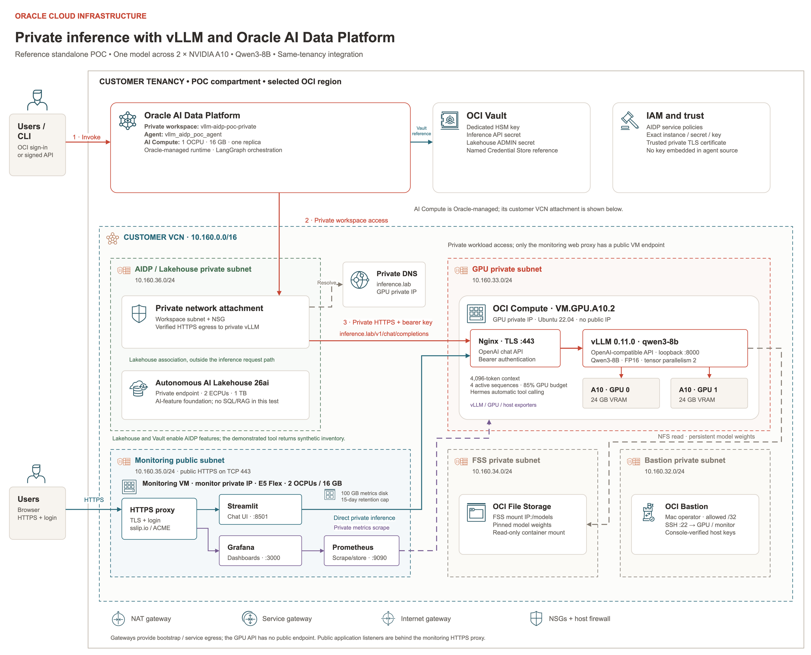

# Customer handover — vLLM and Oracle AI Data Platform

## Overview

This folder contains the source code and instructions for deploying the complete standalone POC in your own OCI tenancy: GPU inference, FSS, monitoring, Streamlit, Oracle AI Data Platform, AI Compute, a baseline coded agent and an optional native AIDP knowledge base with a separate RAG agent.

Extract the entire ZIP before opening this guide. Keep this file beside `README.md`, `docs/`, `scripts/` and `terraform/`. All document links below are relative to this folder and travel with the source.

### Stack architecture



Open the [full-size architecture image](docs/images/04-stack-architecture.png). The baseline stack is shown above. The optional RAG extension reuses these resources; see [RAG architecture and request flow](docs/RAG_KNOWLEDGE_BASE.md). For an editable version, open the **Reference architecture** tab in the [draw.io diagram](diagrams/vllm-aidp-completed-architecture.drawio).

## Preconditions / Prerequisites

- Your own approved OCI API-key profile, existing compartment and deployment permissions.
- A compatible customer-supplied GPU image and regional GPU capacity.
- Python, Terraform and other prerequisites listed in the deployment guide.
- An administrator to review and create the required IAM policies.
- For RAG, the completed baseline deployment, its workspace inventory and permission to manage the dedicated catalog schema, volume and knowledge base.

No demonstration credentials, account configuration, Terraform state, GPU image or model weights are included.

## Procedure

### 1 Extract and verify the package

Extract `customer-vllm-aidp-poc-complete.zip` using your archive application, then open the extracted `customer-vllm-aidp-poc` folder in Terminal:

```bash
cd customer-vllm-aidp-poc
python3 scripts/verify-release.py
```

Expected: `Release integrity verified` with the source-file count. This checks the packaged files against the included manifest without OCI requests; it does not establish publisher authenticity.

### 2 Review inputs and permissions

- [Create the non-admin user, group, compartment and permissions](docs/NON_ADMIN_SETUP.md)
- [Package overview and automation boundaries](README.md)
- [Customer configuration](docs/CONFIGURATION.md)
- [GPU image requirements](docs/GPU_IMAGE_REQUIREMENTS.md)
- [Administrator and IAM instructions](docs/IAM.md)
- [Editable architecture diagram](diagrams/vllm-aidp-completed-architecture.drawio)

### 3 Deploy and validate

Follow [DEPLOYMENT.md](docs/DEPLOYMENT.md) from the first step. It covers OCI profile setup, image import, generation of your own `poc-config.json`, reviewed infrastructure deployment, private connectivity and `vllm_aidp_poc_agent` acceptance.

The deployment guide includes an optional RAG phase after baseline acceptance. It uploads the three fictional Project Aster documents from `integration/rag/documents/`, creates a dedicated schema and managed volume, then connects a separate RAG agent to the existing private model. Native knowledge-base creation and ingestion use the AIDP UI; schema/volume preparation, uploads, publication and acceptance use the included scripts.

Read [RAG_KNOWLEDGE_BASE.md](docs/RAG_KNOWLEDGE_BASE.md) for the full procedure. For the default POC name, the KB is `default.vllm_aidp_poc_rag.aster_knowledge_base` and its agent is `vllm_aidp_poc_rag_agent`. Names derive from your configured POC name. The baseline agent and Streamlit remain direct inference clients.

For routine use, follow [OPERATIONS.md](docs/OPERATIONS.md). For managed workspace and agent phases, use [AIDP_WORKSPACE_AUTOMATION.md](docs/AIDP_WORKSPACE_AUTOMATION.md).

### 4 Validate and operate the RAG extension

From the same populated deployment folder:

```bash
python3 integration/rag/rag.py status
python3 integration/rag/rag.py verify
python3 integration/rag/rag.py ask \
  --query "What is Project Aster's release approval code?"
```

Expected: the five sample acceptance cases pass, and the answer includes `LANTERN-731` with `[01-aster-release-policy.txt]`. In AIDP, open the separate RAG agent → Playground and repeat a sample question. Published-endpoint acceptance and Playground are separate checks.

For later documents, use the upload and manual **Ingest now** steps in the RAG guide. Document changes require ingestion; agent-code changes require deliberate republishing. Do not rerun `connect` for ordinary questions.

### 5 Destroy the POC when finished

Follow [CLEANUP.md](docs/CLEANUP.md) in order. Retain your generated configuration, state and ownership inventories until cleanup verification is complete.

Terraform owns infrastructure and policies. Signed API scripts create the AIDP workspace, AI Compute and coded agent. This release requires explicit AIDP Console runtime, RAG knowledge-base/vector and managed-document cleanup before guarded infrastructure destruction; teardown is not fully unattended.

## Validation Steps

Read [VALIDATION.md](docs/VALIDATION.md) and [VALIDATION.json](VALIDATION.json) for local release checks and their limits. Local validation is not a deployment in your tenancy. Complete the private chat and synthetic tool acceptance in the deployment guide. If RAG is enabled, also require successful native ingestion, all five RAG cases and a cited Playground answer. The sample codes and policies are fictional; they validate retrieval rather than real business facts.

## Rollback

Reading, extracting and verifying the package does not deploy resources. After a deployment begins, use the deployment recovery guidance or the complete cleanup guide. Do not delete state to resolve a failed phase.
