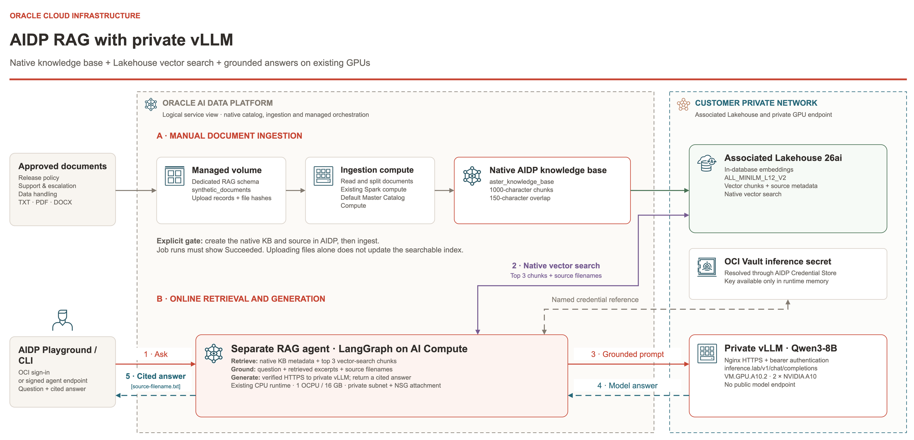

# OCI AIDP RAG Reference

## 🏷️ Tags

#oci #aidp #vllm #terraform #poc #customer-handover

## 🔹 Overview

Reference implementation for deploying, validating, operating and removing private vLLM inference and native RAG with Oracle AI Data Platform (AIDP) in your own OCI tenancy. It includes Terraform, host bootstrap, monitoring, Streamlit and signed API automation for AIDP's private workspace, AI Compute, baseline coded agent and an optional native knowledge-base RAG agent. The customer owns execution, credentials, resource approvals, state, data and cleanup.

## Architecture



The editable [draw.io workbook](diagrams/vllm-aidp-completed-architecture.drawio) contains only the final reference slides 4–6, renumbered as tabs 01–03: stack architecture, RAG request sequence and RAG architecture. Customer-specific tenancy, region and IP details are replaced with generic labels.

## Getting started

Prerequisites include an OCI profile, approved IAM access, Terraform, Python, SSH tooling, an imported compatible Ubuntu GPU image and confirmed regional GPU capacity. See the [deployment guide](docs/DEPLOYMENT.md) for exact requirements and approval steps.

```bash
git clone https://github.com/ibuchh/oci-aidp-rag-reference.git
cd oci-aidp-rag-reference
python3 scripts/verify-release.py
./setup.sh --profile CUSTOMER_POC
```

Replace `CUSTOMER_POC` with your OCI profile name. Setup discovers the target tenancy, compartment, region and availability domain. Review each plan before confirming an apply. Deployment creates billable OCI resources.

For native RAG, follow the [knowledge-base guide](docs/RAG_KNOWLEDGE_BASE.md) after the baseline stack is ready. It includes three fictional Project Aster documents and five acceptance cases. Knowledge-base creation and ingestion use the AIDP Console; the remaining RAG phases have reusable scripts.

## Documentation

Start with these guides:

- [CUSTOMER_HANDOVER.md](CUSTOMER_HANDOVER.md) — start here after extracting the complete ZIP.
- [NON_ADMIN_SETUP.md](docs/NON_ADMIN_SETUP.md) — customer administrator creates the user, deployment group, compartment and scoped access.
- [DEPLOYMENT.md](docs/DEPLOYMENT.md) — OCI profile, GPU image, configuration wizard, full deployment and agent acceptance.
- [RAG_KNOWLEDGE_BASE.md](docs/RAG_KNOWLEDGE_BASE.md) — sample documents, manual native ingestion, separate RAG agent and five-case acceptance.
- [CLEANUP.md](docs/CLEANUP.md) — AIDP runtime removal, inference-secret deletion scheduling, infrastructure destruction and retention checks.
- [IAM.md](docs/IAM.md) — customer administrator responsibilities and split-role deployment.
- [CONFIGURATION.md](docs/CONFIGURATION.md) — customer inputs, fixed baseline and network boundaries.
- [GPU_IMAGE_REQUIREMENTS.md](docs/GPU_IMAGE_REQUIREMENTS.md) — image contract; the customer supplies the compatible image.
- [OPERATIONS.md](docs/OPERATIONS.md) — host health, inference, load generation and dashboards.
- [AIDP_WORKSPACE_AUTOMATION.md](docs/AIDP_WORKSPACE_AUTOMATION.md) — managed runtime phases and recovery.
- [VALIDATION.md](docs/VALIDATION.md) — release-local checks and required customer acceptance.
- [Architecture](diagrams/vllm-aidp-completed-architecture.drawio) — editable reference topology and agent request flow.

## ✅ What is included

- `terraform/`: independent roots for shared networking/FSS, monitoring, GPU VM, AIDP foundation, service IAM, Lakehouse, AIDP, private DNS and Credential Store IAM. The direct-runtime IAM root is optional and is not used by the supported Credential Store flow.
- `scripts/`: account discovery, guarded plan/apply/destroy, host configuration, runtime publication and AIDP data-plane automation.
- `runtime/`: pinned monitoring containers, host exporters, proxy and firewall configuration.
- `apps/streamlit/`: chat UI, image build, authenticated HTTPS deployment and optional Mac launcher.
- `integration/rag/`: schema/volume preparation, synthetic Aster documents, upload and agent scripts, native retrieval adapter and RAG acceptance.
- `integration/aidp/`: private model client, LangGraph agent, identity probe, source renderer and acceptance checks.
- `tests/`: offline controller/account-isolation checks and application/agent tests; Terraform mock-provider tests are colocated with their roots.
- `config/customer.example.json`: neutral defaults. Run setup rather than deploying this incomplete example directly.

Credentials, populated account configuration, deployment inventories, state, API signing/SSH keys, passwords, real certificates, model weights and the GPU image are excluded. No access to the demonstration tenancy is required.

## 🔹 Automation boundaries

Terraform provisions the infrastructure and policies. The pinned provider does not expose the workspace/AI Compute/agent resources used here; `aidp_workspace.py` creates them through signed public OCI requests and records separate ownership. The deployment is guided, with explicit plan/apply confirmations.

**AIDP runtime and native RAG teardown are explicit Console steps in this release.** The destroy script refuses destructive apply until the operator confirms its removal and schedules the recorded inference secret for deletion. An empty Terraform state does not prove retained backups or managed storage have been removed.

The baseline is one GPU VM and one monitoring VM, synthetic data, Qwen3-8B, public authenticated HTTPS for Streamlit/Grafana and private model HTTPS. The optional RAG extension demonstrates synthetic document retrieval through a separate AIDP agent; Streamlit remains a direct model client. It has no HA inference replica, corporate SSO or validated customer-data SQL/RAG rollout. The GPU certificate initially lasts 30 days and needs coordinated trust renewal. Customer network policy must approve the public web/sslip.io/ACME design before apply. Review a different access design before deployment if that design is unsuitable.

## 🔍 Validation and integrity

The reference environment passed private chat, a real coded-agent synthetic tool round trip, native ingestion of the three Aster documents and all five RAG acceptance cases. Native KB creation and ingestion remain UI steps; the other RAG phases are scripted. That is not an assertion that this package has been deployed in the customer's tenancy. The customer must validate regional services/capacity, their image, IAM, private connectivity, TLS, credentials and cleanup.

After cloning this repository, verify the checked-in source files:

```bash
python3 scripts/verify-release.py
```

The repository includes the handover guide, all linked documents, diagram images and editable draw.io source. Manifest verification detects file differences; it does not establish publisher authenticity.

`MANIFEST.json` contains per-file hashes and release adjustments. `VALIDATION.json` contains the performed local checks. `python3 scripts/verify-release.py` checks the distributed source against the manifest; generated config/state are outside the source manifest.

## 📦 Handover record

Before the first apply, record the customer's deployment owner, IAM administrator, region/AD, GPU image owner, state/backup location, web-access approval, TLS renewal owner, model approval and intended cleanup date. Keep customer-generated credentials and full deployment records in customer-controlled protected storage.
