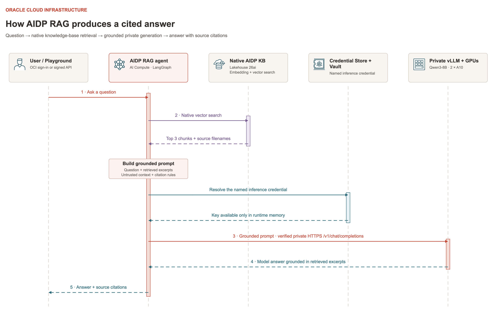

# Customer deployment — standalone vLLM and AIDP

## Overview

Run the phases below in your own OCI tenancy. No demonstration account/profile, image or existing state is required. Keep the package and generated state together until cleanup finishes.

The default POC name `vllm-aidp-poc` produces workspace `vllm-aidp-poc-private`, AI Compute `vllm_aidp_poc_ai_compute` and agent `vllm_aidp_poc_agent`. A different name produces corresponding derived names. The optional RAG phase adds schema `vllm_aidp_poc_rag`, volume `synthetic_documents`, KB `aster_knowledge_base` and agent `vllm_aidp_poc_rag_agent`, reusing the baseline workspace, AI Compute, private inference and AIDP-associated Lakehouse.

## Preconditions / Prerequisites

- A supported Mac or Linux workstation, Python 3.12 or later, OpenSSH, OpenSSL and Terraform 1.7 or later below 2.0. Native Windows is not supported by the POSIX locking/SSH controller; use a compatible Linux environment if appropriate.
- A current Python-based OCI CLI with AIDP support. The reference used OCI CLI 3.96.0, Terraform 1.15.4 and locked OCI provider 9.12.1. Binary workspace upload requires an absolute Python CLI shebang and API-key profile; session-token-only authentication is not implemented by that helper.
- An existing customer compartment and subscribed region with current A10.2 capacity, adequate GPU/network/storage limits and availability of AIDP/Lakehouse/AI Compute. Shape offering is not a capacity reservation.
- A compatible, sanitized GPU image. Read [GPU_IMAGE_REQUIREMENTS.md](GPU_IMAGE_REQUIREMENTS.md). The source package does not install a replacement GPU driver or supply an image.
- An approved API profile and deployment permissions, including policy creation or an IAM administrator for the staged route in [IAM.md](IAM.md).
- Approval for public monitoring/Streamlit TCP 80/443, sslip.io DNS, ACME certificates, external package/container/model downloads and the selected model. Private inference remains private.
- An SSH key pair and the actual public SSH egress IPv4 `/32` for Bastion. Setup also accepts `0.0.0.0/0`, which allows any IPv4 source to reach the Bastion access boundary; SSH authentication and temporary sessions still apply. A browser IP lookup does not prove SSH uses the same egress.
- A non-overlapping private `/16`, checked against connected VPN/peering networks. Confirm sizing/cost internally before applying paid resources.

## Procedure

### 1. Extract, verify and configure the OCI profile

From the directory containing the downloaded complete ZIP:

```bash
unzip customer-vllm-aidp-poc-complete.zip
cd customer-vllm-aidp-poc
export POC_ROOT="$PWD"
umask 077

python3 scripts/verify-release.py
oci --version
terraform version
python3 --version
```

You can also extract the ZIP using your archive application, then run the remaining commands from the extracted folder. Open [CUSTOMER_HANDOVER.md](../CUSTOMER_HANDOVER.md) from that folder for the linked starting guide. Keep the full directory structure together.

Use your organization's approved OCI API-key setup. If needed, `oci setup config` creates a local configuration interactively. Use a distinct profile such as `CUSTOMER_POC`. Register the API public key for the intended OCI user. Keep the API signing key on your workstation; it is separate from the VM SSH key. Do not paste keys into configuration JSON or handover communications. Docker/Compose/Buildx are used on the monitoring VM for the public app build; the installer checks Buildx and installs its package if needed.

Expected: the intended profile exists in `~/.oci/config` and can read its tenancy, region subscriptions and compartment metadata.

### 2. Import or select the customer GPU image

In the selected OCI region, open Compute → Custom Images → Import image using your approved image source. Wait for `AVAILABLE` and verify `VM.GPU.A10.2` compatibility. If an approved compatible image already exists in your tenancy, use it instead. Record its regional OCID.

The monitoring VM uses an automatically discovered Ubuntu 24.04 CPU platform image. It does not require a GPU image.

### 3. Generate your configuration

```bash
./setup.sh --profile CUSTOMER_POC
```

Replace `CUSTOMER_POC` with your actual profile name. You may omit `--profile` to choose from locally configured profiles. Optional arguments are `--region`, `--compartment-id` and `--name`.

Setup discovers the tenancy and IAM home region, asks for a Ready subscribed deployment region and existing compartment, then asks for the POC name, AD, imported GPU image, SSH key, egress `/32` or `0.0.0.0/0`, VCN CIDR and Streamlit username. It writes a mode-0600 `poc-config.json` and creates no cloud resources. It refuses to overwrite an existing configuration.

Review [CONFIGURATION.md](CONFIGURATION.md). Leave `runtime_principal_type` and `runtime_principal_id` null. Keep `state_directory` at `deployments/NAME/states`. Do not change target tenancy/region/name while reusing deployed state.

Confirm capacity and limits before applying. The selected AD places the GPU and monitoring VMs, metrics volume and FSS resources in that AD. The scripts do not provide AD-placement controls for AIDP's managed AI Compute or the Lakehouse. Changing the AD of an existing deployment can replace resources and must be reviewed as a migration, including data backup.

Set these local variables for the later RAG and evidence steps:

```bash
CONFIG=poc-config.json
POC_NAME=$(python3 -c \
  'import json,sys; print(json.load(open(sys.argv[1]))["name"])' \
  "$CONFIG")
DEPLOYMENT_DIR="deployments/$POC_NAME"
POC_PREFIX=$(python3 -c \
  'import json,sys; print(json.load(open(sys.argv[1]))["name"].replace("-", "_"))' \
  "$CONFIG")
```

`POC_PREFIX` is used in schema, compute and agent names; the workspace uses `POC_NAME-private`.

### 4. Run local checks and OCI preflight

```bash
python3 scripts/validate.py
python3 scripts/poc.py preflight
./deploy.sh
```

The first command performs local compilation, Terraform validation/mock tests and controller tests. Provider initialization may access the registry. It makes no OCI API requests or infrastructure applies. Optional Streamlit and agent suites require the declared dependencies; see [VALIDATION.md](VALIDATION.md).

Preflight uses read-only OCI calls. Preview creates local plans only. On empty state, dependent plans wait for shared resource outputs. Neither preflight nor preview reserves GPU capacity.

### 5. Deploy infrastructure, policies and public apps

If your approved profile may create the required IAM policies:

```bash
./deploy.sh \
  --apply \
  --through aidp \
  --ack-aidp-bootstrap-limit
```

Review each plan and enter its exact requested confirmation. Terraform prints filtered resource progress and an elapsed-time heartbeat while retaining full output in private logs. Follow the log path printed for the current stage; earlier inference runs are under `deployments/NAME/states/.pocctl/runs/`, while AIDP-stage runs are under `deployments/NAME/runs/`. Logs can contain sensitive deployment details.

A slow AIDP operation can remain in provisioning or feature enablement after Terraform returns. Check the actual work request and AI-feature state rather than starting a duplicate deployment. If a separate administrator creates policies, use [IAM.md](IAM.md)'s staged sequence instead, then continue at step 6.

The command provisions shared network/FSS, monitoring and GPU resources, configures and validates hosts, provisions the AIDP subnet/Vault/key/ADMIN secret, service policies, private Lakehouse and AIDP, and installs public Streamlit. Do not use `--infra-only` for a full deployment.

Baseline serving is pinned Qwen3-8B with vLLM 0.11.0, FP16, tensor parallelism 2, context 4096, maximum 4 scheduled sequences, GPU memory budget 0.85 and Hermes automatic tool calling. Weights persist on FSS. The monitoring VM is 2 OCPUs/16 GB with a 100 GB metrics disk. Lakehouse is a paid 26ai deployment, 2 ECPUs/1 TB, with autoscaling disabled. AI Compute is added later.

The bootstrap acknowledgment is required by the current controller. If private Lakehouse/AIDP initialization fails, retain successful state and inspect the real work request; do not expose the database publicly or create duplicate paid resources as a retry.

### 6. Validate the baseline and AIDP readiness

```bash
python3 scripts/node.py gpu-health
python3 scripts/node.py monitoring-health
python3 scripts/node.py chat
python3 scripts/node.py tool-test
python3 scripts/poc.py status
```

Expected: two healthy GPUs, healthy monitoring, private chat PASS and an observed tool call. These baseline requests run on the GPU VM and do not yet prove AIDP connectivity.

In OCI Console, wait until AIDP is Active, its AI feature status is Ready and the dedicated Lakehouse is Available. Terraform completion alone is not the final agent acceptance gate. If the existing instance is still creating or its AI features are not Ready, wait for that same instance; after it is Active/Ready, resume the same deployment/configuration. If AI Compute reports CREATING or Installing software, retain its inventory and rerun `aidp_workspace.py connect` after readiness; do not create replacement compute as a retry.

### 7. Prepare the private trust bundle and Vault key

```bash
python3 scripts/poc.py runtime-bundle
python3 scripts/poc.py publish-key
```

Expected: public CA certificate, non-secret runtime configuration and inference-secret metadata under `deployments/NAME/runtime/`. The existing model key is transferred through verified host access into the dedicated Vault. Its value is not placed in Terraform or uploaded agent source. An already recorded Active secret is reused.

### 8. Create private DNS and Credential Store IAM

```bash
python3 scripts/poc.py plan --stage aidp-dns
python3 scripts/poc.py apply --stage aidp-dns

python3 scripts/poc.py plan --stage aidp-credential-iam
python3 scripts/poc.py apply --stage aidp-credential-iam
```

Use the administrator profile configuration from [IAM.md](IAM.md) for the credential-policy commands if your operator cannot create policies.

Expected: private `inference.lab` DNS resolves to your actual GPU IP, and a policy permits the exact AIDP instance to read the exact inference secret bundle, read/update its metadata for required governance tagging and use its dedicated encryption key. This name matches the generated GPU certificate. The generic optional `runtime-iam` stage is not used.

### 9. Create the workspace, AI Compute and coded agent

```bash
python3 scripts/aidp_workspace.py connect \
  --wait-minutes 30
```

This creates the private workspace and exact subnet/NSG attachment, 1-OCPU/16-GB AI Compute with one replica, Credential Store entries, a diagnostic probe and the final coded LangGraph agent. It tests private TLS and credential access before publishing the model entry, then verifies chat and an observed synthetic tool call/result through the deployed AIDP endpoint.

Expected final agent: `vllm_aidp_poc_agent` for the default name. The GPUs remain on the standalone VM; AI Compute runs CPU orchestration in Oracle-managed infrastructure. If installation exceeds the deadline, rerun the same command with the same inventory to resume. Do not create a second compute as a retry.

### 10. Prepare the optional RAG schema and sample documents

Skip steps 10–14 if you only need baseline inference. Complete step 9 first and retain its `aidp-workspace.json`. These commands reuse its exact workspace and AI Compute; they do not create another GPU VM or change Streamlit.

```bash
python3 integration/rag/rag.py prepare \
  --config "$CONFIG" \
  --apply
python3 integration/rag/rag.py status \
  --config "$CONFIG"
```

Expected: `default.POC_PREFIX_rag` and its `synthetic_documents` managed volume are ACTIVE. If creation was accepted but the schema or volume is not yet visible, inspect the asynchronous operation in AIDP and rerun the same `prepare` command after it succeeds. Keep `rag/inventory.json`; do not adopt an unrelated resource with the same name.

Then upload the three bundled synthetic TXT files:

```bash
python3 integration/rag/rag.py upload-documents \
  --config "$CONFIG" \
  --apply
```

Expected: three successful uploads, or `Already recorded uploaded` for unchanged files. The helper uses the Python/OCI SDK belonging to OCI CLI when required and records SHA-256 hashes in the RAG inventory.

### 11. Create the native knowledge base and ingest the volume

In AIDP, navigate to **Master catalog → default → POC_PREFIX_rag**. Use **Add to schema → Knowledge base** or the Knowledge Bases create control. Create `aster_knowledge_base` with:

- Embedding model `ALL_MINILM_L12_V2`.
- Chunk size **1000 characters**, overlap **150 characters**.
- The existing ingestion Spark cluster, or leave the optional cluster unset to use Default Master Catalog Compute. AI Compute runs the agent; it is separate from ingestion Spark compute.

Wait for the KB to be Active. Open it → **Data Source** → the plus button. Select the whole volume `/Volumes/default/POC_PREFIX_rag/synthetic_documents`, enable **TEXT**, keep **Start ingestion job on add** selected, and add the source. Select the volume source → **Job runs** and wait for **Succeeded**, with **3 files added, 0 modified and 0 deleted** on the initial empty-volume run. Save the job ID and completion time.

Substitute the actual `POC_PREFIX`; the UI does not expand shell variables. The packaged public-API helper does not create or ingest native KBs. These are explicit UI steps. See [Oracle knowledge-base procedures](https://docs.oracle.com/en/cloud/paas/ai-data-platform/aidug/knowledge-bases.html).

### 12. Publish the separate RAG agent

Only after the native KB exists and ingestion succeeds:

```bash
python3 integration/rag/rag.py record-kb \
  --config "$CONFIG" \
  --apply
python3 integration/rag/rag.py connect \
  --config "$CONFIG" \
  --apply
```

`record-kb` records the default KB identity; it does not create the KB or prove retrieval. `connect` renders account-specific source under `deployments/NAME/rag/`, uploads it to the separate `POC_PREFIX_rag_agent`, publishes its endpoint, waits for ACTIVE and runs all five acceptance cases. Generated source contains public trust and credential identifiers; the inference key and vector-store credentials remain in the runtime.

If the endpoint wait times out while the service is still creating it, inspect the same owned deployment and resume readiness/validation without publishing another version:

```bash
python3 integration/rag/rag_poc.py wait \
  --config "$CONFIG"
python3 integration/rag/rag.py verify \
  --config "$CONFIG"
```

Expected: `RAG acceptance: PASS` in `deployments/NAME/rag/rag-acceptance.json`. Retrieval uses native AIDP helpers and Lakehouse vectors, followed by private vLLM generation. Revalidate the runtime adapter after AIDP upgrades. Do not republish for ordinary questions or document-only updates.

The published RAG agent follows this sequence:



Open the [full-size request flow](images/05-aidp-rag-flow.png). The request uses native KB retrieval before private vLLM generation. The [editable draw.io diagram](../diagrams/vllm-aidp-completed-architecture.drawio) includes this as the **AIDP RAG request flow** tab.

### 13. Verify RAG in AIDP Playground

Open **NAME-private → Agents → POC_PREFIX_rag_agent → Playground**. On the first opening, allow the test runtime to deploy; select the same existing AI Compute if prompted and wait for Active. Test:

- “What are Project Aster's release approval code and rollback verification phrase?” → `LANTERN-731`, `MAPLE-4729`, citation `[01-aster-release-policy.txt]`.
- “Which queue handles Project Aster's first escalation?” → `ORCHID-DESK`, citation `[02-aster-support.txt]`.
- “What was Project Aster's annual revenue for 2027?” → `The knowledge base does not contain that information.`

These are fictional test facts. The KB does not add RAG to the original baseline agent or Streamlit. Both the deployed endpoint and Playground must be tested independently.

### 14. Update documents manually later

Upload files directly inside an explicitly selected directory:

```bash
python3 integration/rag/rag.py upload-documents \
  --config "$CONFIG" \
  --documents-dir /absolute/path/to/documents \
  --apply
```

The helper accepts TXT, PDF and DOCX, skips unchanged owned filenames and overwrites changed ones. It does not traverse subdirectories, remove old remote files or start ingestion. If new file types are added, enable those types in the native source configuration. In AIDP open the source → **Parameters → Ingest now**, then wait for a successful Job run and test a changed fact with its citation. An upload alone does not update searchable vectors. Deleting local files alone does not remove remote files or indexed content.

The five included acceptance questions apply to the bundled Aster documents. For your own documents, define replacement expected facts, citation checks and unsupported questions. Use only data approved for this POC and model path. See [RAG_KNOWLEDGE_BASE.md](RAG_KNOWLEDGE_BASE.md) for the extension's files and recovery workflow.

## Validation Steps

```bash
python3 scripts/aidp_workspace.py status
python3 scripts/aidp_workspace.py invoke-inference
```

Required report fields:

```json
{
  "status": "PASS",
  "stage": "coded_agent",
  "private_chat_verified": true,
  "tool_observed": true,
  "synthetic_inventory_verified": true,
  "final_answer_present": true
}
```

The Mac invokes the signed AIDP endpoint; the actual model requests execute from AI Compute. This is distinct from a direct Streamlit request. The baseline tool returns synthetic inventory. RAG is validated separately through its own agent and `rag-acceptance.json`; a baseline PASS does not establish retrieval.

Open the newly generated Grafana/Streamlit URLs and their separate generated credentials in `deployments/NAME/states/.pocctl/`. Verify authenticated Streamlit works and unauthenticated access is denied. Send a synthetic prompt and watch Grafana's last-15-minute inference/GPU/host dashboards. In the AIDP web UI, select `NAME-private` → Agents → `NAME_with_underscores_agent` → Test/Playground and confirm the attached Active compute. Browser Playground behavior is a separate check from deployed-endpoint acceptance. For the baseline agent, inspect TEST metadata with:

```bash
python3 scripts/aidp_workspace.py playground-status
```

This reads service metadata and updates the local inventory; it does not certify chat. If Playground returns `SIGNER_AVAILABLE` or older probe JSON, deselect its Playground compute, reselect the same existing compute with **Select & Deploy**, wait for Active and start a new session. Keep the published endpoint. Use the same refresh procedure for stale RAG test code, then ask a cited sample question.

## Rollback

Successful phases remain available for diagnosis. If the customer elects to remove the stack, use [CLEANUP.md](CLEANUP.md), using automated `--include-runtime` cleanup or its manual alternative, followed by retention verification. Do not erase state or manually remove lifecycle protections to force an apply.
