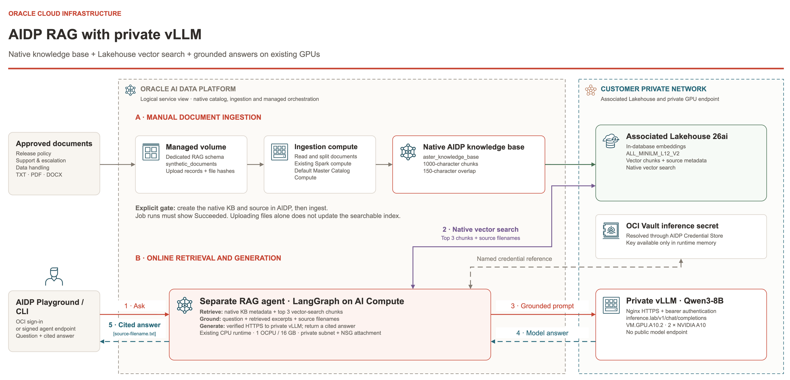
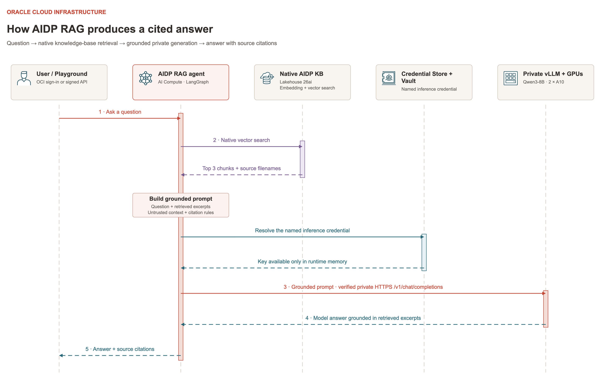

# Native AIDP knowledge base with private vLLM answers

## Overview

This extension targets the configured OCI deployment using the profile and region in `poc-config.json`. It ingests three fabricated Project Aster TXT documents into a native AIDP knowledge base and uses the private Qwen3-8B endpoint for answer generation.

Request flow: OCI-signed agent request → existing private AI Compute → native AIDP knowledge-base lookup and Lakehouse vector search → retrieved excerpts → verified private HTTPS vLLM `/v1/chat/completions` → answer with source filenames.

The native vector store is the existing AIDP-associated Lakehouse. Ingestion reuses the existing Default Master Catalog Compute. Agent execution reuses `vllm_aidp_poc_ai_compute`; the baseline `vllm_aidp_poc_agent` is separate from the new `vllm_aidp_poc_rag_agent`.

### RAG architecture



Manual ingestion builds the searchable index. Online requests retrieve source chunks and use the existing private model to produce cited answers.

### RAG request sequence



Open the full-size [RAG architecture](../../docs/images/06-aidp-rag-architecture.png) or [request sequence](../../docs/images/05-aidp-rag-flow.png). Both figures are editable in the [draw.io diagram](../../diagrams/vllm-aidp-completed-architecture.drawio), using the **AIDP RAG architecture** and **AIDP RAG request flow** tabs. The images are bundled with this guide and can be opened at full size.

## Preconditions / Prerequisites

- Existing same-tenancy stack and original `poc-config.json`, not a freshly extracted generic package.
- AIDP Active, AI features Ready, Lakehouse available and required AIDP catalog/workspace/knowledge-base permissions.
- Healthy existing private inference, DNS, explicit CA trust and Credential Store Vault reference.
- Initial acceptance uses synthetic data; the bundled facts are not real Oracle or customer policies. Use only approved documents for later custom uploads.
- Current managed runtime must include the AIDP retrieval helpers and LangGraph. Their interfaces are runtime-version dependent, so rerun acceptance after upgrades.

Schema and agent names derive from the configured POC name with hyphens replaced by underscores. The examples below use `vllm-aidp-poc`; substitute your configured name.

## Configuration and ownership

- Standard catalog: `default`.
- Dedicated schema: `vllm_aidp_poc_rag`.
- Managed volume: `synthetic_documents`.
- Knowledge base: `aster_knowledge_base`.
- Embeddings: `ALL_MINILM_L12_V2`, using in-database embedding support.
- Chunk size: 1000 characters, overlap: 150 characters.
- Retrieval: top 3 chunks.
- Answer model: existing private `qwen3-8b`, temperature 0, output limit 512 tokens.
- Ownership, source hashes and native-ingestion evidence: `deployments/vllm-aidp-poc/rag/`.

The public AIDP SDK used during implementation exposes schema/volume/agent APIs but no knowledge-base client operations. Native KB creation and source ingestion were performed through AIDP's UI. The code does not claim Terraform ownership of these data-plane objects. No new IAM grants or separate Spark cluster are part of this extension.

## Procedure

### 1. Inspect the existing extension

Run from the extracted `customer-vllm-aidp-poc` package root:

```bash
python3 integration/rag/rag_poc.py status
```

Prepare and upload the bundled synthetic samples from the package root:

```bash
python3 integration/rag/rag.py prepare --apply
python3 integration/rag/rag.py upload-documents --apply
```

If prepare reports a pending-discovery message, retain the inventory and run `python3 integration/rag/rag.py status`. Status shows the recorded operation and its current state even before the schema/volume key is discoverable. After readiness, rerun the same prepare command to reconcile the accepted creation and continue with the next resource. It does not submit a duplicate create for an accepted pending request. Wait until both schema and volume are ACTIVE before uploading documents. Failed/canceled operations, changed intents and ambiguous matches remain errors.

For a deliberately new supported deployment, `rag_poc.py prepare --apply` creates the schema/volume with an ownership inventory and retry tokens. `rag.py upload-documents --apply` uploads the bundled TXT files, records hashes and selects the OCI CLI Python/SDK if the initial interpreter lacks OCI. Use `--documents-dir` explicitly for later approved TXT/PDF/DOCX documents. Name collisions without ownership are rejected. A timed-out create must be reconciled against its persisted intent rather than blindly adopted or recreated.

### 2. Find the knowledge base in AIDP

Open the AIDP instance → Master catalog → `default` → `vllm_aidp_poc_rag` → Knowledge Bases → `aster_knowledge_base`.

In Data Source, select `synthetic_documents` → Job runs. Wait for a successful ingestion with all three sample files processed. Parameters identify the managed volume path and reused ingestion compute. Native jobs are separate from the agent's AI Compute.

If recreating manually, create the KB with the embedding/chunk settings above, then add the entire volume `/Volumes/default/vllm_aidp_poc_rag/synthetic_documents`, select TEXT only and start ingestion. Wait for successful completion before testing. Use the plus button beside the Data Source filter to add the volume. AIDP takes a volume/folder as the source rather than individual files. Re-ingest changed sources explicitly; this POC adds no scheduled ingestion.

### 3. Connect the separate RAG agent

After the native KB exists and ingestion succeeds, record its identity and publish the isolated agent:

```bash
python3 integration/rag/rag.py record-kb --apply
python3 integration/rag/rag.py connect --apply
```

Expected: the endpoint becomes ACTIVE and all five sample acceptance checks pass. These commands require the existing deployed stack and its workspace inventory.

### 4. Ask a question through the deployed RAG endpoint

```bash
python3 integration/rag/rag_poc.py invoke \
  --query "What is Project Aster's release approval code?"
```

Expected: the synthetic approval code with a source citation, generated using retrieved KB text. The CLI prints the signed endpoint response and stores it in `deployments/vllm-aidp-poc/rag/last-response.json`.

For a structured diagnostic report with retrieved chunks:

```bash
python3 integration/rag/rag_poc.py invoke \
  --query "__RAG_VERIFY__:What is Project Aster's release approval code?"
```

In AIDP's private workspace, open agent `vllm_aidp_poc_rag_agent` to review the generated entry and attached compute. The signed deployed endpoint is the acceptance path used by the CLI. To use AIDP directly, open that agent → Playground. The first opening can deploy the separate test runtime; wait for the chat controls. If asked for compute, select the existing AI Compute listed in the workspace. Ask a sample question below and check the filename citation. After later code changes, check a new Playground session separately from the deployed endpoint; refresh its compute attachment through the UI if it still serves older code.

The existing Streamlit app still calls vLLM directly. It has not been changed into a RAG client by creating this knowledge base.

### 5. Manually update documents

For later use, upload TXT, PDF or DOCX files from a directory you select:

```bash
python3 integration/rag/rag.py upload-documents \
  --documents-dir /absolute/path/to/documents \
  --apply
```

The script skips unchanged file hashes and overwrites changed owned filenames. It does not remove old files or start ingestion. In AIDP open the KB source → Parameters → Ingest now, then wait for Job runs → Succeeded. New source folders or file types must also be selected in the native source configuration. The included acceptance suite checks the synthetic Aster facts; supply your own expected facts when replacing them.

### 6. Publish deliberate agent-code updates

```bash
python3 integration/rag/rag.py record-kb --apply
python3 integration/rag/rag.py connect --apply
```

Do not republish for routine questions. Publishing can create a new deployment version; the inventory preserves the old version IDs for cleanup. Generated source contains public trust and credential identifiers, never the bearer key or database password. Keep it with the account-specific deployment records rather than distributing it as generic customer source.

## Validation Steps

Validated in Ashburn on 2026-11-11: native ingestion succeeded with 3 files added, 0 modified and 0 deleted. All five deployed endpoint acceptance cases passed. The included RAG unit suite passes 12 tests, covering ownership reconciliation, grounded generation, citations and private wallet cleanup.

Example Playground questions:

- What are Project Aster's release approval code and rollback verification phrase?
- Which queue handles Project Aster's first escalation?
- What was Project Aster's annual revenue for 2027?

Expected: LANTERN-731 and MAPLE-4729 with the release-policy citation; ORCHID-DESK with the support citation; the exact information-not-found response for revenue.


Ordinary RAG answers include a correlation ID. Diagnostic mode also returns retrieved chunks and private inference HTTP, timing and completion metadata. These reports contain source excerpts; keep them with deployment records.

```bash
python3 integration/rag/verify_rag.py
```

Acceptance checks four document-grounded questions and one unsupported question. Each positive answer must contain the expected fact, retrieve supporting text and cite the correct filename. All cases must actually use native retrieval and private vLLM. The unsupported revenue question must return the documented information-not-found response.

The report is saved as `deployments/vllm-aidp-poc/rag/rag-acceptance.json`. This report, not KB creation alone, establishes the tested end-to-end result.

Local tests require the baseline agent dependencies, including LangGraph:

```bash
python3 -m unittest discover -s integration/rag/tests -v
```

## Rollback and teardown

Use [CLEANUP.md](../../docs/CLEANUP.md) step **2a** for RAG-only removal: undeploy every RAG endpoint version, detach its Playground test runtime/agent, stop ingestion, remove the KB source/vectors and KB, then remove owned original files/volume, the empty dedicated schema and the exact RAG code folder. Confirm ownership from `rag/inventory.json` and preserve its evidence.

Stop after that section for RAG-only removal. Keep the baseline agent, shared AI Compute/workspace, ingestion compute, Credential Store, inference secret, DNS, Lakehouse, GPU/FSS and monitoring. Recheck baseline inference. Continue the remaining cleanup phases only for a deliberately chosen whole-stack teardown. For automatic whole-stack removal, use `destroy.sh --include-runtime` in the cleanup guide. It removes the recorded RAG originals and cascade-deletes only the owned dedicated RAG schema, including its KB/vectors and managed volume. RAG-only cleanup remains the manual procedure.

Deleted vectors can be rebuilt only when the original documents are available. Re-upload/re-ingest the backed-up originals and rerun RAG acceptance; hashes or generated agent source do not restore documents.
